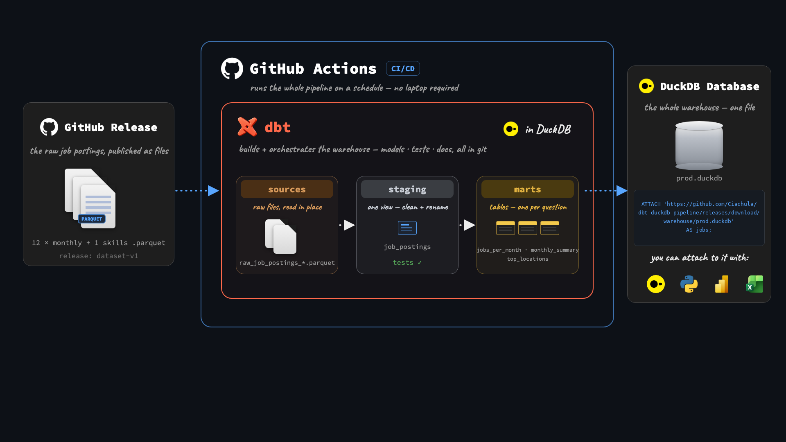
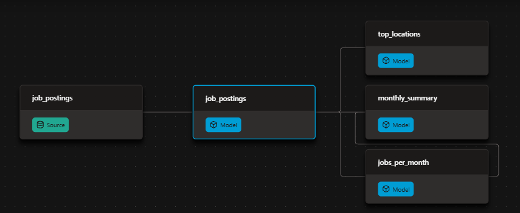

# Automated Job Postings Pipeline (v1) - dbt + DuckDB

[](https://github.com/Ciachula/dbt-duckdb-pipeline/actions/workflows/dbt_build.yml)
[](https://ciachula.github.io/dbt-duckdb-pipeline/)



A fully automated **dbt + DuckDB** data pipeline that turns **~692k real job postings** into tested, documented analytical marts, then rebuilds and publishes them on every push.

- Transforms raw job postings into **clean, tested, and documented insight marts**
- Publishes both the **documentation site** and the **finished data warehouse**, open to anyone with no credentials needed
- Runs on its own with **GitHub Actions**: on every push to `main` and every Monday

> **v1 of this pipeline** uses a free, local-friendly stack: DuckDB as the data warehouse and GitHub Actions as the scheduler and CI/CD. [v2](../project_2/) rebuilds it as a production-grade pipeline on Databricks.

| What I Built | How I Implemented | Where to Look |
| --- | --- | --- |
| **dbt pipeline** | sources → cleaned staging model → insight marts | [`analytics/models/`](analytics/models/) |
| **Data tests** | `unique` / `not_null` tests on the grain of every mart | [`schema.yml`](analytics/models/schema.yml) |
| **Hosted dbt docs** | lineage graph, model descriptions, column tests | [Live docs site](https://ciachula.github.io/dbt-duckdb-pipeline/) |
| **Public CI/CD** | build, test, and publish on every push | [Actions workflow](https://github.com/Ciachula/dbt-duckdb-pipeline/actions/workflows/dbt_build.yml) |
| **Environments** | separate local `dev` and CI `prod` targets | [`ci/profiles.yml`](ci/profiles.yml) |
| **Published warehouse** | a single `ATTACH` makes it queryable by anyone | [Query it](#-query-the-published-warehouse) |

---

## ⚙️ The dbt Pipeline

Raw job postings move through three dbt layers: **declared sources → cleaned staging views → insight marts**. Data tests run as part of every build, so bad data never reaches the marts. The DAG below shows the complete flow:



Key dbt features used in the project:

| dbt Feature | How I Used It |
| --- | --- |
| Declared sources (no hardcoded paths in SQL) | [`sources.yml`](analytics/models/sources.yml) + `source('raw', 'job_postings')` |
| Model dependencies | `ref()` in all downstream models, so dbt determines build order and parallelism automatically |
| Materializations | `table` as the project default, with staging models overridden to `view` |
| Data tests | `unique` / `not_null` on mart grains in [`schema.yml`](analytics/models/schema.yml) |
| Environments | local `dev` and CI `prod` targets ([`ci/profiles.yml`](ci/profiles.yml)) |

`dbt build` compiles the SQL, materializes the models, runs the tests, and **fails the run if any test fails**. The same command is used locally and in CI.

---

## 🚀 Production

The entire pipeline runs on GitHub Actions, with no local machine required: [`.github/workflows/dbt_build.yml`](.github/workflows/dbt_build.yml)

| Trigger | What happens |
| --- | --- |
| Push to `main` | Full rebuild |
| Weekly (Monday) | Scheduled rebuild that keeps the data fresh |
| Manual (`workflow_dispatch`) | On-demand run from the Actions UI |

Each run:

1. Installs dependencies with `uv`
2. Downloads the raw parquet data
3. Runs `dbt build` using the committed CI profile (`prod`)
4. Publishes `prod.duckdb` as a GitHub Release asset

The badge at the top of this README shows the status of the latest run.

---

## 🦆 Query the published warehouse

No need to clone the repo. [Install DuckDB](https://duckdb.org/docs/installation/) (e.g. `brew install duckdb` on macOS or `winget install DuckDB.cli` on Windows), then run in a `duckdb` session:

```sql
INSTALL httpfs;
LOAD httpfs;

ATTACH 'https://github.com/Ciachula/dbt-duckdb-pipeline/releases/download/warehouse/prod.duckdb' AS jobs;
USE jobs;
SHOW TABLES;

SELECT * FROM top_locations;
SELECT * FROM monthly_summary;
```

---

## 📖 Docs

The documentation is generated with `dbt docs generate` and published to GitHub Pages:

**→ [ciachula.github.io/dbt-duckdb-pipeline](https://ciachula.github.io/dbt-duckdb-pipeline/)**

The site includes:

- The full **lineage graph** (sources → models → marts)
- **Model and column descriptions** defined in YAML
- Which columns are covered by **tests**

---

## 💻 Run it yourself

```bash
uv sync
uv run python scripts/download_data.py
cd analytics && uv run dbt build
```

To view the docs locally (optional):

```bash
uv run dbt docs generate
uv run dbt docs serve
```

---

## 📁 Project layout

```text
.
├── .github/workflows/dbt_build.yml   # public CI: build, test, publish
├── ci/profiles.yml                   # prod DuckDB target for Actions
├── data/                             # raw data + warehouses (gitignored; CI regenerates them)
├── docs/                             # dbt docs site (GitHub Pages)
├── analytics/
│   ├── dbt_project.yml
│   └── models/                       # sources, staging, marts, schema.yml
└── scripts/download_data.py          # downloads raw parquet before the build
```

---

*Inspired by Luke Barousse's [dbt for Data Analytics & Engineering course](https://www.lukebarousse.com). Dataset: real job postings collected daily.*
